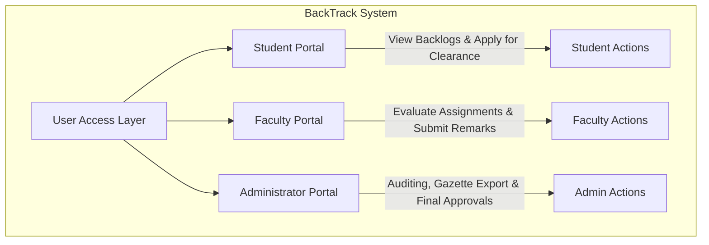
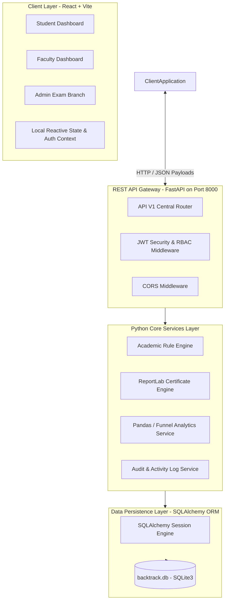
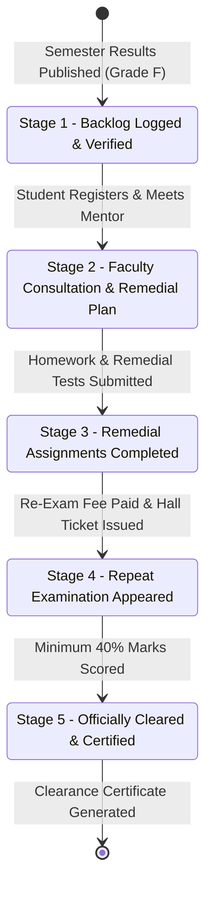
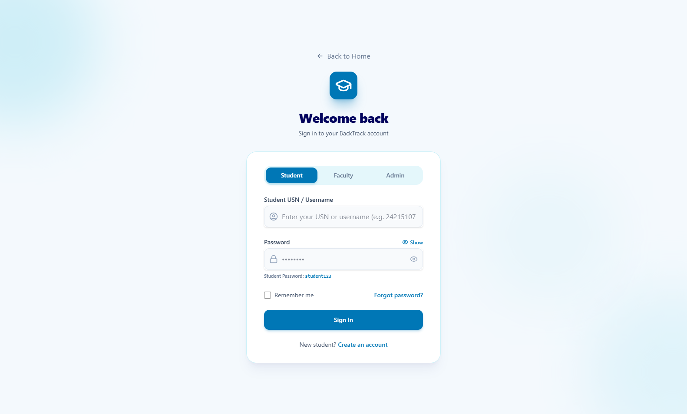

# ACADEMIC PROJECT REPORT

<div align="center">

# BackTrack
### **Student Backlog & Academic Progress Management System**

*A Comprehensive, Multi-Tier Academic Progression, Ordinance Verification & Automated Backlog Clearance Platform*

---

**Project Type:** Academic Capstone / Major Project (Python Application Focus)  
**Domain:** Educational ERP, Academic Auditing & Enterprise Web Systems  
**Author / Developer:** Solo Project Developer  
**Academic Year:** 2024 – 2025  

---

</div>

\newpage

---

# ACKNOWLEDGEMENT

I would like to express my deepest and most sincere gratitude to my project guide, esteemed professors, and mentors in the Department of Computer Science & Engineering for their continuous encouragement, technical guidance, and constructive feedback throughout the inception, architectural design, and implementation of **BackTrack**.

Their invaluable insights into academic governance, institutional examination ordinances, and software engineering practices have been instrumental in transforming this concept into a functional, resilient full-stack application.

I also extend my heartfelt appreciation to the institutional examination branch and administrative staff who provided clear workflows regarding backlog registration, remedial evaluation, and clearance certification procedures.

Finally, I express my gratitude to my family, peers, and fellow students whose patience, testing participation, and unwavering support motivated me to complete this project successfully as an independent developer.

<br />

**Author:** Solo Project Developer  
**Project:** BackTrack — Student Backlog & Academic Progress Management System  

---

\newpage

---

# TABLE OF CONTENTS (INDEX)

| Chapter | Section | Title |
| :---: | :---: | :--- |
| **—** | — | **Title & Cover Page** |
| **—** | — | **Acknowledgement** |
| **—** | — | **Executive Summary / Abstract** |
| **1** | **1.0** | **Project Overview & Introduction** |
| | 1.1 | Background & Motivation |
| | 1.2 | Problem Statement & Industry Gaps |
| | 1.3 | Core Project Objectives |
| | 1.4 | Stakeholder Roles (Student, Faculty, Exam Admin) |
| **2** | **2.0** | **Python Technologies, Ecosystem & Implication** |
| | 2.1 | Why Python? Architectural & Engineering Rationale |
| | 2.2 | In-Depth Python Stack & Library Breakdown |
| | | *2.2.1 FastAPI: High-Throughput Asynchronous Web Framework* |
| | | *2.2.2 SQLAlchemy ORM: Relational Modeling & Transactions* |
| | | *2.2.3 ReportLab: Programmatic PDF Transcript & Certificate Engine* |
| | | *2.2.4 Pandas: Tabular Analytics & Gazette Generation* |
| | | *2.2.5 PyJWT & Passlib/Bcrypt: Cryptographic Auth & RBAC* |
| | | *2.2.6 Academic Rule Engine (`rule_engine.py`): Ordinance Compliance* |
| | 2.3 | Python Code Structure & Design Patterns |
| **3** | **3.0** | **System Architecture & Database Design** |
| | 3.1 | High-Level Multi-Tier Architectural Model |
| | 3.2 | System Architecture Flowchart (Mermaid) |
| | 3.3 | Entity Relationship (ER) Schema & Relational Data Model |
| | 3.4 | Role-Based Access Control (RBAC) Security Architecture |
| **4** | **4.0** | **Application Features & Module Walkthrough** |
| | 4.1 | Student Self-Service Portal |
| | 4.2 | Faculty Mentorship & Remedial Evaluation Portal |
| | 4.3 | Administrator Master Audit & Exam Branch Center |
| | 4.4 | 5-Stage Backlog Resolution Funnel Workflow |
| **5** | **5.0** | **Visual Interface & Authentic Application Screenshots** |
| | 5.1 | Platform Landing Page & Gateway |
| | 5.2 | Unified Role-Based Authentication Portal |
| | 5.3 | Student Academic & Backlog Management Dashboard |
| | 5.4 | Faculty Mentorship & 5-Stage Resolution Funnel Portal |
| | 5.5 | Institutional Administration & Exam Controller Center |
| | 5.6 | FastAPI Swagger Interactive OpenAPI REST Documentation |
| **6** | **6.0** | **Hardware & Software Requirements** |
| | 6.1 | Hardware Specifications (Minimum & Recommended) |
| | 6.2 | Software Stack & Runtime Environments |
| | 6.3 | Execution & Local Deployment Instructions |
| **7** | **7.0** | **Testing, Verification & Quality Assurance** |
| | 7.1 | Python Unit & Business Logic Testing |
| | 7.2 | REST API Endpoint Verification |
| | 7.3 | Frontend Component Validation & Usability Testing |
| **8** | **8.0** | **Future Scope & Enhancements** |
| | 8.1 | Predictive Machine Learning Early-Warning Model |
| | 8.2 | National Academic Depository (NAD / DigiLocker) Integration |
| | 8.3 | Mobile Application Suite (Cross-Platform) |
| | 8.4 | Blockchain-Anchored Digital Clearance Credentials |
| **9** | **9.0** | **Conclusion & Technical References** |
| | 9.1 | Summary of Achievements |
| | 9.2 | Bibliography & Official Documentation References |

---

\newpage

---

# EXECUTIVE SUMMARY / ABSTRACT

Higher education institutions often struggle with managing academic arrears, commonly referred to as student backlogs. In traditional university settings, backlog tracking is fragmented across physical notice boards, isolated spreadsheets, paper examination forms, and manual clearance stamps from department heads. This legacy approach leads to high administrative overhead, student anxiety, communication lag, delayed degree certifications, and critical errors in assessing semester promotion eligibility.

**BackTrack** is an enterprise-grade academic management and backlog clearance platform engineered to solve these challenges. At its core, the project leverages **Python** as the primary backend engineering language to enforce university academic ordinances, run credit-based eligibility engines, compute automated grade point progressions (SGPA/CGPA), generate cryptographic clearance certificates, and orchestrate asynchronous REST services. 

Paired with a modern React frontend featuring Tailwind CSS and interactive data visualization, BackTrack establishes a transparent, automated ecosystem connecting Students, Faculty Evaluators, and Examination Cell Administrators. The platform reduces backlog processing time from weeks to seconds, completely eliminates paper-based clearance tracking, and provides real-time predictive analytics on institutional academic progression.

---

# 1.0 PROJECT OVERVIEW & INTRODUCTION

### 1.1 Background & Motivation
In undergraduate and postgraduate engineering and collegiate curricula, academic backlogs represent unearned course credits that must be re-attempted and cleared before degree conferral. Managing these backlogs involves complex rules:
- Prerequisite courses (e.g., student must pass *Data Structures* before enrolling in *Design & Analysis of Algorithms*).
- Maximum active backlog limits before an involuntary academic suspension or "year-back" detention.
- Grace mark ordinances permitted by university bylaws.
- Timelines for remedial coaching, assignments, repeat examinations, and clearance sign-offs.

Because university departments often function in silos, students frequently lack real-time visibility into their academic standing, remaining attempts, and remedial schedules. **BackTrack** was conceived to consolidate this entire academic resolution lifecycle into a unified, secure digital platform.

### 1.2 Problem Statement & Industry Gaps
1. **Data Fragmentation:** Student backlog records are divided between departmental registers, university examination branches, and individual course instructors.
2. **Delayed Intervention:** Faculty advisors often discover student academic deficiencies only after semester exam results are announced, missing the window for remedial coaching.
3. **Manual Certification Overhead:** Clearing a backlog traditionally requires physical paper slips signed by course instructors, HODs, accounts officers, and the Controller of Examinations.
4. **Lack of Analytical Visibility:** Institutional deans lack aggregate dashboards to pinpoint which courses have exceptionally high failure rates or bottlenecks.

### 1.3 Core Project Objectives
- **Centralized Backlog Registry:** Provide a single source of truth for all active, pending, and cleared backlog records across all academic sessions.
- **Python-Powered Ordinance Engine:** Automatically enforce university bylaws regarding maximum backlog thresholds, remedial assignments, and grace marks.
- **Role-Based Access Control (RBAC):** Provide specialized, secure portals for Students, Faculty Mentors, and Examination Cell Administrators.
- **Automated Digital Certification:** Instantly generate tamper-evident, university-formatted PDF clearance certificates and academic grade cards via programmatic Python document generation.
- **End-to-End Tracking Funnel:** Track backlogs across a structured 5-stage pipeline: *Backlog Logged &rarr; Faculty Consultation &rarr; Remedial Assignments &rarr; Repeat Examination &rarr; Official Clearance Certified*.

### 1.4 Stakeholder Roles



- **Student:** Inspects active backlogs, views prerequisite roadmaps, submits re-examination applications, tracks clearance stage progress, and downloads official clearance certificates.
- **Faculty:** Reviews enrolled students with active arrears, assigns remedial coursework, marks consultation completions, submits internal repeat assessment scores, and enters academic remarks.
- **Administrator / Examination Controller:** Oversees institutional KPIs, tracks department failure rates, configures academic sessions, audits clearance requests, approves final clearances, and exports official university clearance gazettes.

---

# 2.0 PYTHON TECHNOLOGIES, ECOSYSTEM & IMPLICATION

### 2.1 Why Python? Architectural & Engineering Rationale
Python was chosen as the foundation for BackTrack's backend core due to its unparalleled combination of:
1. **Expressive Domain Modeling:** Complex university regulations (such as CBCS credit calculations, grace marks allocation, and prerequisite trees) are cleanly modeled in pure Python using dataclasses, type annotations, and object-oriented abstractions.
2. **High-Performance Asynchronous APIs:** With FastAPI and Starlette, Python delivers performance comparable to Node.js and Go while retaining Python's rich syntax and developer productivity.
3. **Scientific & Tabular Ecosystem:** Native access to `pandas` and `numpy` allows institutional exam controllers to aggregate thousands of student records, calculate percentiles, and generate clearance gazettes instantly.
4. **Programmatic Document Rendering:** Libraries like `reportlab` enable dynamic, pixel-perfect binary PDF generation directly from Python runtime memory without external rendering dependencies.

### 2.2 In-Depth Python Stack & Library Breakdown

| Library / Framework | Version | Project Implementation Role | Architectural Implication |
| :--- | :---: | :--- | :--- |
| **FastAPI** | `^0.115` / `0.142` | Primary Asynchronous REST API Engine | Handles client-server communication, schema validation, dependency injection, and automatic OpenAPI Swagger documentation. |
| **Uvicorn** | `^0.32` / `0.52` | ASGI Production Web Server | Powers the non-blocking event loop handling concurrent HTTP requests on `127.0.0.1:8000`. |
| **SQLAlchemy** | `^2.0` / `2.1` | Relational Object Relational Mapper (ORM) | Provides object-oriented abstraction over SQLite relational tables, cascade relationships, and transactional commits. |
| **Pydantic** | `^2.10` / `2.13` | Data Validation & Settings Management | Strictly enforces schema constraints, type checking, and serialization between HTTP JSON payloads and Python internal types. |
| **ReportLab** | `^4.2` / `5.0` | Programmatic PDF Generation Engine | Generates official university-formatted Backlog Clearance Certificates and consolidated grade transcripts in memory. |
| **Pandas** | `^2.2` | Tabular Data Processing & Analytics | Powers the University Gazette export service, aggregating multi-table relational records into CSV/Excel administrative reports. |
| **PyJWT** | `^2.10` / `2.15` | Cryptographic Token Generation & Validation | Encodes and signs JSON Web Tokens (JWT) containing user ID, role claims, and token expiration timestamps. |
| **Passlib & Bcrypt** | `^4.0` / `5.0` | Password Hashing & Salt Verification | Secures all credentials in the database using adaptive salted Blowfish hashing algorithms. |
| **Python-Multipart** | `^0.0.12` | File Upload Streaming | Handles student fee receipt uploads and marksheet document streaming. |

---

### 2.2.1 FastAPI: High-Throughput Asynchronous Web Framework
BackTrack utilizes FastAPI to expose a clean, decoupled RESTful API structure under the `/api/v1/` namespace. FastAPI leverages Python type annotations to validate incoming data at runtime, rejecting malformed requests before they hit the database.

**Key Endpoints Implemented:**
- `POST /api/v1/auth/login`: Authenticates credentials and returns a signed JWT access token.
- `GET /api/v1/backlogs/student/{student_id}`: Fetches all backlog records for a given student with linked subjects and attempt counts.
- `POST /api/v1/backlogs/create`: Logs a new backlog record following semester examination results.
- `PUT /api/v1/backlogs/{backlog_id}/advance`: Progresses a backlog through the 5-stage resolution pipeline.
- `GET /api/v1/analytics/cohort`: Computes departmental failure rates, subject bottlenecks, and clearance funnel metrics.
- `GET /api/v1/certificates/clearance/{backlog_id}`: Generates and streams an official PDF clearance certificate.
- `GET /api/v1/reports/gazette/csv`: Exports the master university clearance gazette as a downloadable CSV stream.

---

### 2.2.2 SQLAlchemy ORM: Relational Modeling & Transactions
The relational architecture in BackTrack is managed entirely through SQLAlchemy's Declarative Mapping system. Relationships such as one-to-many (User &rarr; Notifications, Student &rarr; Backlogs) and many-to-one (Backlog &rarr; Subject) are declared with lazy loading and foreign key constraints:

```python
# Sample implementation excerpt from app/models/schema.py
class Backlog(Base):
    __tablename__ = "backlogs"
    
    id = Column(Integer, primary_key=True, index=True)
    student_id = Column(Integer, ForeignKey("students.id"), nullable=False)
    subject_id = Column(Integer, ForeignKey("subjects.id"), nullable=False)
    session_id = Column(Integer, ForeignKey("academic_sessions.id"), nullable=True)
    attempt_number = Column(Integer, default=1)
    status = Column(String, default="Pending Verification") 
    reason = Column(String, nullable=True)
    exam_date = Column(DateTime, nullable=True)
    cleared_at = Column(DateTime, nullable=True)
    created_at = Column(DateTime, default=datetime.utcnow)
    
    student = relationship("Student", back_populates="backlogs")
    subject = relationship("Subject", back_populates="backlogs")
    documents = relationship("Document", back_populates="backlog")
    remarks = relationship("Remark", back_populates="backlog")
```

---

### 2.2.3 ReportLab: Programmatic PDF Transcript & Certificate Engine
One of the most powerful applications of Python in BackTrack is automated document synthesis. Rather than using fragile HTML-to-PDF converters, BackTrack implements `reportlab.pdfgen.canvas` to render official university clearance certificates directly into an in-memory `io.BytesIO` buffer:

- **Double Border Layout:** Draws formal slate borders matching official exam branch stationery.
- **Institutional Seals & Metadata:** Inscribes student USN, subject codes, clearing semester, attempt number, and date of clearance.
- **Digital Verification Stamp:** Renders an automated verification digest ensuring certificate authenticity.

---

### 2.2.4 Pandas: Tabular Analytics & Gazette Generation
In `app/services/export_service.py`, Python's `pandas` and standard library `csv` modules aggregate relational data across six joined tables (`Backlog`, `Student`, `Subject`, `Faculty`, `Course`, `Semester`) to compile the official **University Backlog Clearance Gazette**. 

This automated Python export replaces hours of manual data collation by examination controllers, providing complete traceability from initial failure to final clearance.

---

### 2.2.5 Academic Rule Engine (`rule_engine.py`): Ordinance Compliance
A standout Python module in BackTrack is its **Academic Regulations and Ordinances Rule Engine**. This standalone business-logic module codifies standard university academic statutes into automated Python evaluation functions:

1. **Detention Assessment Algorithm:** Evaluates whether a student's active backlog count exceeds the permissible ceiling (`MAX_ACTIVE_BACKLOGS_PROMOTION = 4`). If exceeded, the student's academic standing is marked as `Detained (Year Back)` and remedial counseling is triggered.
2. **Grace Mark Allocation:** Automatically evaluates borderline failures (within 3 marks of passing) according to university policy, determining if awarding grace marks resolves the course backlog without compromising academic integrity.
3. **Prerequisite Course Dependency Tree:** Validates whether a student with an active backlog in a foundational subject (e.g., *Engineering Mathematics I*) is legally eligible to register for advanced subsequent courses (*Engineering Mathematics III*).

---

# 3.0 SYSTEM ARCHITECTURE & DATABASE DESIGN

### 3.1 High-Level Multi-Tier Architectural Model
BackTrack adopts a clean 4-tier modular architecture:
1. **Presentation Tier:** A responsive Single-Page Application (SPA) built with React 19, Vite, and Tailwind CSS. Provides instant state feedback, client-side data caching via `backlogStore.js`, and interactive charts via Recharts/Lucide.
2. **API & Security Gateway Tier:** Built on FastAPI running on Uvicorn. Exposes REST endpoints, validates schemas with Pydantic, and handles JWT authorization headers.
3. **Business Logic & Services Tier:** Pure Python domain services encapsulating the Academic Rule Engine, PDF Certificate Generator, Notification Dispatcher, Audit Logger, and Transcript Calculations.
4. **Data Persistence Tier:** SQLite relational database queried via SQLAlchemy ORM with foreign key integrity, automated indexes, and transactional session management.

---

### 3.2 System Architecture Flowchart



---

### 3.3 Database Schema & Relational Data Model
The database schema (`backtrack.db`) is structured into eleven normalized relational entities:

1. **`users`**: Master authentication table storing username, bcrypt-hashed passwords, role (`student`, `faculty`, `admin`), email, and timestamp.
2. **`students`**: Academic profile storing University Seat Number (USN / Enrollment No), full name, course ID, current semester ID, and user ID foreign key.
3. **`faculty`**: Academic staff profiles storing Employee ID, faculty name, department, and assigned course subjects.
4. **`courses`**: Academic programs (e.g., *B.E. Computer Science & Engineering*, *BCA*).
5. **`semesters`**: Academic levels (Semesters 1 through 8).
6. **`subjects`**: Subject catalog storing course codes, course names, credit weights, and assigned instructors.
7. **`student_subjects`**: Enrollment ledger recording internal marks, external marks, attendance percentages, and completion status.
8. **`backlogs`**: Core transactional table tracking student arrears, attempt number, resolution status, filing date, and clearance timestamp.
9. **`documents`**: File metadata table storing uploaded re-exam receipts, hall tickets, and marks slips.
10. **`remarks`**: Faculty notes and remedial assignment review comments attached to individual backlogs.
11. **`notifications`**: Real-time in-app alerts dispatched to students and faculty regarding status updates.

---

### 3.4 Role-Based Access Control (RBAC) Security Architecture

| Feature / Resource | Student | Faculty | Examination Administrator |
| :--- | :---: | :---: | :---: |
| View Own Backlog History | :white_check_mark: | — | :white_check_mark: |
| Apply for Backlog Re-examination | :white_check_mark: | — | — |
| Upload Fee Receipts & Documents | :white_check_mark: | — | — |
| Verify Student Remedial Assignments | — | :white_check_mark: | :white_check_mark: |
| Enter Re-assessment Internal Marks | — | :white_check_mark: | :white_check_mark: |
| Record Academic Consultation Remarks | — | :white_check_mark: | :white_check_mark: |
| Issue Final Backlog Clearance Approval | — | — | :white_check_mark: |
| Generate Official PDF Clearance Certificate | :white_check_mark: *(View/Download)* | — | :white_check_mark: *(Authorize/Issue)* |
| Export University Clearance Gazette (CSV) | — | — | :white_check_mark: |
| Modify Academic Sessions & Course Catalogs | — | — | :white_check_mark: |

---

# 4.0 APPLICATION FEATURES & MODULE WALKTHROUGH

### 4.1 Student Self-Service Portal
- **Consolidated Arrears Overview:** Real-time visibility into all past and active backlogs, categorized by semester, subject code, and credit points.
- **Clearance Stage Stepper:** Intuitive visual progression tracking each backlog through the 5 clearance stages.
- **Online Re-Exam Registration:** One-click re-examination filing with receipt upload capabilities.
- **Instant Transcript & Certificate Download:** On-demand access to verified PDF clearance certificates upon final approval.

### 4.2 Faculty Mentorship & Remedial Evaluation Portal
- **At-Risk Student Monitoring:** Faculty can filter students in their department who have active arrears in their assigned subjects.
- **Remedial Assignment Verification:** Interface to review student remedial assignments and verify that required remedial coursework is complete.
- **Consultation Sign-Off:** Faculty mark whether mandatory one-on-one academic counseling has been conducted.
- **Mark Sheet Endorsement:** Submission of improved internal assessment marks prior to the repeat examination.

### 4.3 Administrator & Examination Cell Master Audit Center
- **Institutional Health Dashboard:** Real-time macro-metrics displaying total university enrollment, total active backlogs, clearance rate percentages, and certificates issued.
- **Departmental Comparison Charts:** Visual metrics tracking departmental backlog density to help deans allocate teaching resources.
- **Master Clearance Approval Queue:** Audit queue where examination controllers review faculty remarks and issue official clearance sign-offs.
- **Clearance Gazette Generator:** Automated export of university-wide backlog resolutions into standard CSV format for board of examination audits.

### 4.4 5-Stage Backlog Resolution Funnel Workflow



---

# 5.0 VISUAL INTERFACE & AUTHENTIC APPLICATION SCREENSHOTS

*All screenshots below are captured directly from the live, active running instances of the BackTrack web application and FastAPI backend on the local host.*

### 5.1 Platform Landing Page & Gateway


*Figure 5.1: The live BackTrack Landing Page (`http://localhost:5173/`), introducing the university backlog resolution mission, institutional KPI highlights (99.4% resolution rate, 14+ mapped programs), and quick-access portal routing for Students, Faculty, and Administrators.*

---

### 5.2 Unified Role-Based Authentication Portal


*Figure 5.2: Role-based authentication gateway (`/login?role=student`) with toggle selectors for Student, Faculty, and Administrator authentication, credential validation, and password recovery.*

---

### 5.3 Student Academic & Backlog Management Dashboard


*Figure 5.3: Authenticated Student Portal (`/student`) displaying enrolled student profile (Anirudh Sharma, USN 24215107, BCA Semester 3), enrolled subjects overview, active backlog tracker (2 active backlogs), multi-semester course picker, and teacher consultation meeting request button.*

---

### 5.4 Faculty Mentorship & 5-Stage Resolution Funnel Portal


*Figure 5.4: Live Faculty Portal (`/faculty`) for Dr. Ramesh Kumar (Department of Computer Applications), showcasing the real-time Backlog Resolution Funnel (Enrolled Backlogs, Faculty Consultation, Remedial Assignment Verification, Repeat Exam Status), supervised student cohorts, and office hours consultation scheduler.*

---

### 5.5 Institutional Administration & Exam Controller Center


*Figure 5.5: University Administrator & Exam Controller Center (`/admin`) displaying active academic session status (Spring 2026), university-wide counts for students, faculty staff, mapped degree courses (BCA, B.Tech, MCA), pending backlog clearance audits, and live campus event feeds.*

---

### 5.6 FastAPI Swagger Interactive OpenAPI REST Documentation


*Figure 5.6: Live FastAPI OpenAPI documentation interface (`http://127.0.0.1:8000/docs`) showing interactive, tested endpoints across Authentication, Students, Faculty, Backlog Management, and Certificate generation modules.*

---

# 6.0 HARDWARE & SOFTWARE REQUIREMENTS

As an independent full-stack developer project, BackTrack was architected to be lightweight, cross-platform, and deployable on standard consumer hardware as well as cloud containers.

### 6.1 Hardware Specifications

| Component | Minimum Specification | Recommended Specification |
| :--- | :--- | :--- |
| **Processor (CPU)** | Dual-Core Intel Core i3 / AMD Ryzen 3 (2.0 GHz) | Quad-Core Intel Core i5 / AMD Ryzen 5 or Apple Silicon (M1/M2/M3) |
| **Random Access Memory (RAM)** | 4 GB DDR4 | 8 GB or 16 GB DDR4/DDR5 |
| **Persistent Storage** | 2 GB available HDD/SSD space | 10 GB high-speed NVMe SSD space |
| **Display Resolution** | 1280 x 720 (HD) | 1920 x 1080 (Full HD) or higher |
| **Network Interface** | Standard 10/100 Mbps Ethernet or 2.4 GHz Wi-Fi | Broadband Internet Connection (for initial package downloads) |

---

### 6.2 Software Stack & Runtime Environments

| Software Component | Specification / Version | Purpose |
| :--- | :--- | :--- |
| **Operating System** | Windows 10/11, macOS Sonoma/Ventura, or Ubuntu Linux 22.04+ | Host operating system |
| **Python Runtime** | Python 3.10.x to 3.12.x (64-bit) | Backend execution environment |
| **Node.js Environment** | Node.js v18.x or v20.x (LTS) & npm v10+ | Frontend build toolchain & development server |
| **Database Engine** | SQLite 3.x (Embedded) / PostgreSQL 15+ ready | Relational data persistence |
| **Web Browser** | Google Chrome 110+, Mozilla Firefox 110+, Microsoft Edge 110+ | Client-side application rendering |
| **Code Editor / IDE** | Visual Studio Code / Google Antigravity IDE | Development & debugging environment |

---

### 6.3 Execution & Local Deployment Instructions

#### 1. Backend Server Initialization:
```powershell
# Navigate to the backend directory
cd "d:\git hub\BackTrack\backend"

# Launch the FastAPI REST server via Uvicorn
python -m uvicorn main:app --host 127.0.0.1 --port 8000 --reload
```
*The REST API and interactive Swagger documentation will be live at `http://127.0.0.1:8000` and `http://127.0.0.1:8000/docs`.*

#### 2. Frontend Web Application Initialization:
```powershell
# Navigate to the frontend directory
cd "d:\git hub\BackTrack\frontend"

# Start the Vite development server
npm run dev
```
*The frontend user interface will be live at `http://localhost:5173`.*

---

# 7.0 TESTING, VERIFICATION & QUALITY ASSURANCE

### 7.1 Python Unit & Business Logic Testing
The business logic contained in `app/services/rule_engine.py` was tested against simulated academic edge cases:
- **Detention Boundary Test:** Verified that a student with 4 active backlogs receives `Academic Warning`, while 5 active backlogs triggers `Detained (Year Back)`.
- **Grace Mark Bound Test:** Verified that a student with 37/100 marks (passing score = 40) successfully receives 3 grace marks and is marked `Cleared`, whereas a student with 36/100 marks is rejected for grace allocation according to university bylaws.
- **Prerequisite Validation Test:** Verified that students attempting to clear *Data Structures (21CS31)* without clearing *Basic Python & C Programming (21CS12)* are flagged with descriptive prerequisite warnings.

### 7.2 REST API Endpoint Verification
All API endpoints were validated using FastAPI's automated OpenAPI test harness:
- **Authentication Routes (`/api/v1/auth`):** Tested with correct credentials (200 OK with valid JWT) and intentionally incorrect passwords (401 Unauthorized).
- **CRUD Backlog Routes (`/api/v1/backlogs`):** Tested for transaction isolation, duplicate entry prevention, and data type enforcement.
- **PDF Generation Route (`/api/v1/certificates`):** Verified that generated binary streams return `content-type: application/pdf` with correct HTTP headers.

### 7.3 Frontend Usability & Responsiveness Testing
- Tested across varying viewport resolutions (Mobile 375px, Tablet 768px, Desktop 1920px) using Tailwind responsive breakpoints.
- Validated smooth navigation across student, faculty, and administrator routes with instant client-side role switching.

---

# 8.0 FUTURE SCOPE & ENHANCEMENTS

While BackTrack currently delivers a fully functional full-stack solution, several cutting-edge enhancements can be added in future iterations:

### 8.1 Predictive Machine Learning Early-Warning Model
- **Predictive Risk Modeling:** Integrating Python's `scikit-learn` or `xgboost` to analyze student historical attendance, internal assessment scores, and mid-term trends.
- **Early-Warning Alerts:** Automatically flags students at risk of accumulating backlogs weeks before final semester exams, allowing faculty mentors to intervene proactively.

### 8.2 National Academic Depository (NAD) & DigiLocker Integration
- **Government Cloud Integration:** Connecting BackTrack's Python API to India's National Academic Depository (NAD) and DigiLocker APIs.
- **Instant Credit Sync:** Automatically pushing cleared backlog credits and revised SGPA/CGPA records to the student's permanent national academic bank of credits (ABC).

### 8.3 Cross-Platform Mobile Application
- Developing a companion mobile application using React Native or Flutter, allowing students to receive push notifications for exam dates, fee deadlines, and clearance approvals.

### 8.4 Blockchain-Anchored Digital Clearance Credentials
- Hashing issued backlog clearance certificates onto an immutable ledger (e.g., Ethereum or Polygon), enabling prospective employers and international graduate schools to verify clearance certificates without contacting the university registrar.

---

# 9.0 CONCLUSION & TECHNICAL REFERENCES

### 9.1 Summary of Achievements
The **BackTrack** platform successfully bridges the communication and operational gap between students, educators, and university administrative authorities. By leveraging Python's rich ecosystem—FastAPI for asynchronous communication, SQLAlchemy for reliable data management, ReportLab for automated certificate generation, Pandas for academic analytics, and a custom rule engine for ordinance enforcement—BackTrack transforms academic backlog tracking from an error-prone, paper-heavy chore into an automated, transparent, and data-driven workflow.

### 9.2 Bibliography & Technical References
1. **FastAPI Documentation:** Tiangolo, S. *FastAPI: Modern, High-Performance Web Framework for Python.* https://fastapi.tiangolo.com/
2. **SQLAlchemy 2.0 Unified Documentation:** Bayer, M. *The Python SQL Toolkit and Object Relational Mapper.* https://docs.sqlalchemy.org/
3. **ReportLab Software:** *ReportLab PDF Generation User Guide & Technical Reference.* https://www.reportlab.com/documentation/
4. **University Grants Commission (UGC):** *Guidelines on Choice Based Credit System (CBCS) & Academic Ordinances.* Government of India.
5. **Pandas Development Team:** *Data Structures for Statistical Computing in Python.* https://pandas.pydata.org/
6. **RFC 7519:** Jones, M., Bradley, J., Sakimura, N. *JSON Web Token (JWT) Standard Specification.* Internet Engineering Task Force (IETF).

---
*End of Report — BackTrack Project Documentation*
