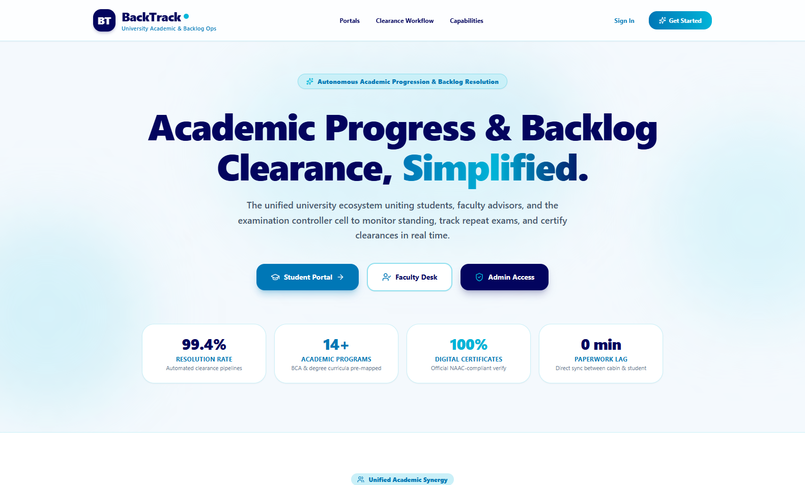
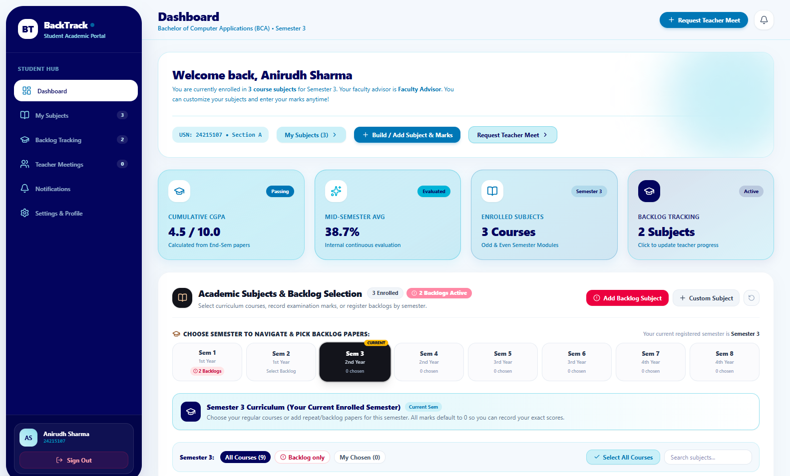
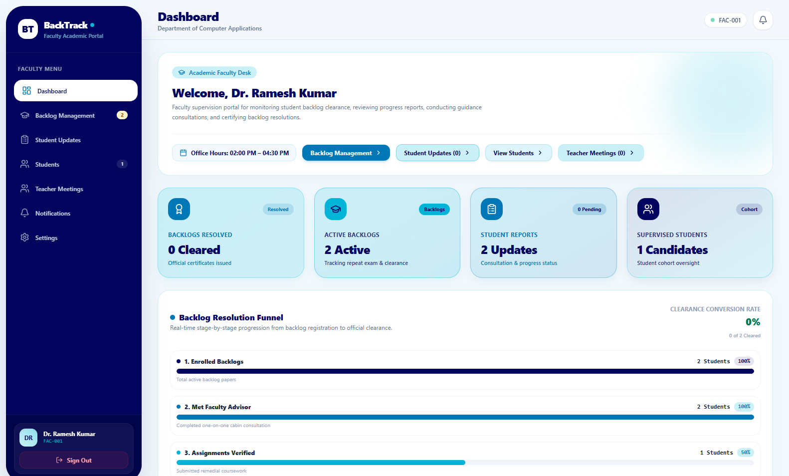
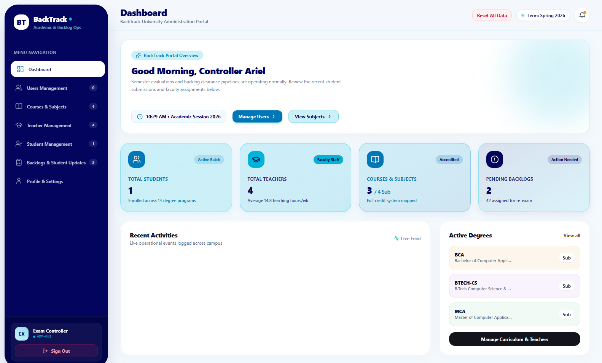
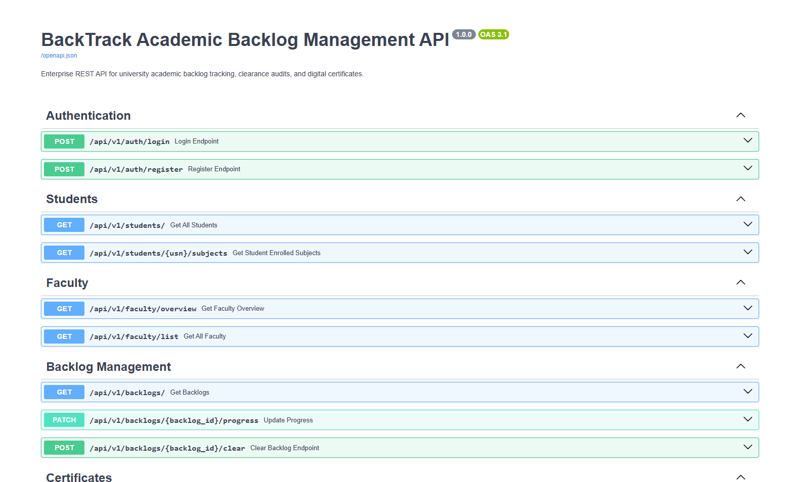

# BackTrack — Student Backlog & Academic Progress Management System

<div align="center">



### *An Enterprise Academic Progression, Ordinance Verification & Backlog Resolution Platform*

[](https://fastapi.tiangolo.com/)
[](https://react.dev/)
[](https://vitejs.dev/)
[](https://tailwindcss.com/)
[](https://www.python.org/)
[](https://www.sqlalchemy.org/)

</div>

---

## 📌 Overview

**BackTrack** is a modern, full-stack academic governance and backlog management system. Built to replace fragmented, paper-reliant academic tracking, BackTrack bridges the communication and operational gap between **Students**, **Faculty Mentors**, and **Institutional Administrators / Examination Controllers**.

Featuring an asynchronous **FastAPI REST backend** and a reactive **React 19 + Vite** single-page frontend, the platform automates ordinance verification, grace mark calculations, multi-stage remediation funnels, and programmatic digital clearance certificate generation.

---

## ✨ Key Features & Portals

### 🎓 1. Student Self-Service Portal
- **Real-Time Backlog Tracking:** View active, pending, and cleared backlogs with credit counters and semester categorization.
- **Academic Progression Monitor:** Check SGPA/CGPA history, ordinance compliance, and credit requirements.
- **Remedial Consultation Booking:** Schedule one-on-one advisory sessions with designated faculty subject mentors.
- **Official Digital Credentials:** Download tamper-proof digital transcripts and clearance certificates upon completion.

### 👨‍🏫 2. Faculty Mentorship Desk
- **5-Stage Resolution Funnel:** Guide students through clear progression milestones:
  1. *Backlog Enrollment* ➔ 2. *Faculty Advisory Session* ➔ 3. *Remedial Assignment Submission* ➔ 4. *Repeat Examination* ➔ 5. *Official Clearance*.
- **Cohort Supervisions:** Review student academic performance, prerequisite compliance, and remedial task submissions.
- **Office Hours Consultation Management:** View and manage student appointment requests and provide academic feedback.

### 🏛️ 3. Institutional Administration & Exam Controller Center
- **Institutional Analytics:** Live campus KPIs covering total enrollment, active backlogs, clearance resolution rates, and departmental metrics.
- **Academic Ordinance Rule Engine:** Automated boundary testing for student detention warnings and grace-mark allocation rules.
- **Audit Logs & Master Reports:** Export comprehensive academic gazettes and tabular reports via Pandas.
- **Batch Backlog Processing:** Audit and endorse exam controller clearances with isolated database transactions.

---

## 📸 Interface Preview

<div align="center">

### Student Academic & Backlog Portal

*Course overview, backlog status, semester filters, and teacher consultation requests.*

<br/>

### Faculty Advisory & Remedial Funnel Desk

*5-stage resolution pipeline, assigned student cohorts, and remedial consultation calendar.*

<br/>

### Institutional Administration & Exam Center

*Session status, institutional metrics, department summaries, and pending audit approvals.*

<br/>

### Interactive Swagger REST API

*Fully documented and interactive OpenAPI documentation available at `/docs`.*

</div>

---

## 🛠️ Technology Stack

| Layer | Technologies |
| :--- | :--- |
| **Frontend** | React 19, Vite, Tailwind CSS v4, Lucide Icons, Recharts, React Router v7, Axios |
| **Backend** | Python 3.10+, FastAPI (Asynchronous REST API), Uvicorn |
| **Database & ORM** | SQLite 3 (Embedded development) / PostgreSQL ready, SQLAlchemy ORM |
| **Document & Data Engine** | ReportLab (Programmatic PDF Certificates), Pandas (Gazette & Tabular Analytics) |
| **Security & Auth** | PyJWT (JSON Web Tokens), Bcrypt password hashing, Role-Based Access Control (RBAC) |

---

## 📁 Repository Structure

```text
BackTrack/
├── backend/                  # FastAPI Application
│   ├── app/
│   │   ├── api/v1/           # Modular REST routes (auth, students, faculty, backlogs, etc.)
│   │   ├── crud/             # SQLAlchemy database queries and CRUD abstractions
│   │   ├── models/           # Relational database schemas & session management
│   │   ├── schemas/          # Pydantic request/response validation models
│   │   ├── scripts/          # Database seeder (seed_database.py), inspector, backups
│   │   ├── services/         # Academic rule engine, PDF certificate generator, export service
│   │   └── utils/            # JWT authentication & security utilities
│   ├── main.py               # FastAPI entry point & CORS configuration
│   └── requirements.txt      # Python dependencies
├── frontend/                 # React 19 + Vite Web Application
│   ├── src/
│   │   ├── components/       # UI modals, cards, charts, and layout elements
│   │   ├── pages/            # Role-specific portals (Student, Faculty, Admin, Login, Landing)
│   │   ├── services/         # Axios API client integrations
│   │   └── App.jsx           # Client-side routing & auth context
│   ├── package.json          # Frontend dependencies & scripts
│   └── vite.config.js        # Vite build tool configuration
├── screenshots/              # Application UI demonstration captures
├── PROJECT_REPORT.md         # Comprehensive academic documentation and system specifications
└── README.md                 # Project documentation
```

---

## 🚀 Getting Started

### Prerequisites
- **Python:** 3.10 or higher
- **Node.js:** v18.0 or higher (with `npm`)

---

### 1. Backend Setup

```bash
# Navigate to the backend directory
cd backend

# (Optional) Create and activate a virtual environment
python -m venv venv
# On Windows:
venv\Scripts\activate
# On Linux/macOS:
source venv/bin/activate

# Install required Python dependencies
pip install -r requirements.txt

# Seed the database with sample academic data and course structures
python app/scripts/seed_database.py

# Launch the FastAPI REST API server
python -m uvicorn main:app --host 127.0.0.1 --port 8000 --reload
```

> 🌐 **Backend API:** `http://127.0.0.1:8000`  
> 📑 **Interactive Swagger Docs:** `http://127.0.0.1:8000/docs`  
> 📚 **ReDoc Documentation:** `http://127.0.0.1:8000/redoc`

---

### 2. Frontend Setup

```bash
# Open a new terminal and navigate to the frontend directory
cd frontend

# Install Node dependencies
npm install

# Start the Vite development server
npm run dev
```

> 💻 **Frontend Application:** `http://localhost:5173`

---

## 🔐 Role-Based Portals & User Roles

BackTrack includes dedicated workspaces for each institutional stakeholder. Pre-configured user roles available in the seed database:

| Role | Username | Description |
| :--- | :--- | :--- |
| **Exam Controller / Admin** | `admin` | Full institutional oversight, ordinance audit, and clearance approvals |
| **Faculty Mentor** | `faculty1` | Department mentoring, 5-stage funnel tracking, and student consultations |
| **Student** | `student1` | Backlog status tracking, consultation scheduling, and certificate downloads |

> **Security Note:**  
> In accordance with security best practices, user passwords are not published in this public documentation. System administrators and authorized users can authenticate using their provisioned credentials or customize user credentials directly through the backend configuration and database seeder (`backend/app/scripts/seed_database.py`).

---

## 🧪 Testing & Verification

Run automated tests on business logic and ordinance rules:

```bash
cd backend
python -m pytest tests/
```

- **Rule Engine Validation:** Verifies boundary conditions for academic detention warnings and grace-mark allocations.
- **REST API Endpoints:** Validates JWT authentication challenges, role guards, and data integrity.
- **PDF Generation:** Verifies binary stream rendering for certificates and official academic gazettes.

---

## 📄 License

This project was developed for academic and institutional evaluation. All rights reserved.
